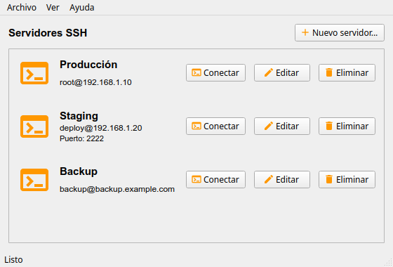
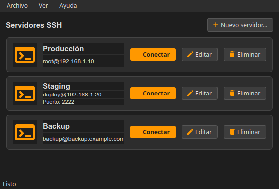
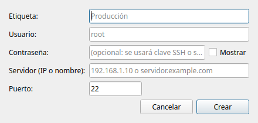
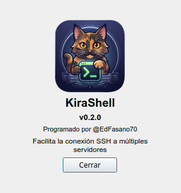

# KiraShell

Aplicación de escritorio que facilita abrir consolas SSH a distintos servidores.
Registra cada servidor con una **etiqueta**, **usuario**, **contraseña** y
**dirección IP o nombre**, y los muestra organizados en tarjetas desde las que
puedes **Conectar**, **Editar** o **Eliminar**.

## Capturas

| Ventana principal | Modo oscuro |
| --- | --- |
|  |  |

| Nuevo servidor | Acerca de |
| --- | --- |
|  |  |

Estructura plana: todo el código en `main.py`, los recursos en `resources/` y `src/`
reservado para futuros módulos.

```
main.py            # toda la aplicación (MainWindow, diálogos, persistencia, main())
resources/         # logo.png + icons/*.svg
docs/screenshots/  # capturas para el README
src/               # vacío (para módulos futuros)
tests/             # pytest
pyproject.toml     # ruff + pytest + metadatos
```

## Requisitos

- Python 3.10 o superior
- PyQt6
- Un emulador de terminal en el PATH (xterm, xfce4-terminal, gnome-terminal,
  konsole, tilix, alacritty o kitty)
- `ssh` (siempre) y `sshpass` (opcional, para conectar con contraseña sin teclearla)

## Setup

No se usa entorno virtual. Solo necesitas PyQt6, pytest y ruff en tu usuario:

```bash
python3 -m pip install --user --break-system-packages PyQt6 pytest ruff
```

`--user` escribe en `~/.local` y `--break-system-packages` es necesario en Debian/Ubuntu
(regla PEP 668). No hace falta instalar el proyecto: `python main.py` y `pytest` funcionan
directamente desde la raíz.

## Run

```bash
python main.py
```

## Uso

1. Usa **Archivo → Nuevo servidor...** (o el botón **Nuevo servidor...**) e indica:
   - **Etiqueta** — nombre con el que identificarás el servidor (p. ej. "Producción").
   - **Usuario** — usuario SSH (p. ej. `root`).
   - **Contraseña** — opcional. Si la dejas vacía, `ssh` la pedirá al conectar
     (o usará tu clave SSH).
   - **Servidor (IP o nombre)** — p. ej. `192.168.1.10` o `servidor.example.com`.
   - **Puerto** — puerto SSH (22 por defecto).
2. El servidor aparece como tarjeta. Pulsa **Conectar** para abrir la consola SSH
   en tu emulador de terminal.
3. Usa **Editar** / **Eliminar** para modificar o quitar servidores.
4. Usa **Archivo → Importar servidores...** / **Exportar servidores...** para
   respaldar o restaurar la lista en formato XML.

## Importar / Exportar (XML)

La lista de servidores puede guardarse o cargarse desde un archivo XML con esta
estructura:

```xml
<servers>
  <server>
    <label>Producción</label>
    <username>root</username>
    <password>clave</password>
    <host>192.168.1.10</host>
    <port>22</port>
  </server>
</servers>
```

Al exportar se guardan todos los servidores; al importar se añaden los válidos
(etiqueta, usuario, host y puerto correctos) y se omiten los que no lo sean.

## Cómo se conecta

KiraShell abre el primer emulador de terminal que encuentre en el PATH y ejecuta:

```bash
sshpass -p 'clave' ssh -o StrictHostKeyChecking=accept-new usuario@servidor
```

- Si hay contraseña guardada, la pasa con `-p` a `sshpass`, ejecutando `ssh` con el formato:
  `sshpass -p '{password}' ssh usuario@servidor`.
- Si no hay contraseña o no existe `sshpass`, ejecuta `ssh usuario@servidor` y el terminal
  pide la contraseña de forma interactiva.

## Test / Lint

```bash
pytest
pytest tests/test_main.py::test_menus
ruff check .
ruff format .
```

## Persistencia

- Preferencias (geometría de ventana y tema): `~/.config/kirashell/config.xml`.
- Servidores guardados: `~/.config/kirashell/servers.json`.

La contraseña se guarda codificada en Base64 (ofuscación, **no** cifrado real) y el
archivo `servers.json` se crea con permisos `0600`. Para máxima seguridad, considera
usar claves SSH en lugar de contraseña.
